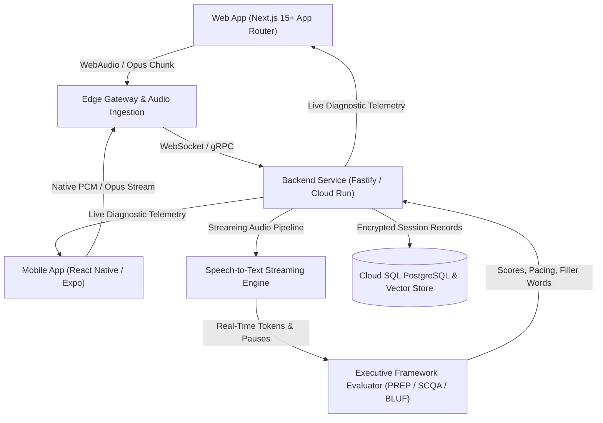

# ExecutiveVoice System Architecture

## 1. Executive Summary & Domain Purpose
**ExecutiveVoice** is an enterprise-grade articulation training platform engineered specifically for managers transitioning into Director, Vice President, and C-Suite leadership roles. 

### Core Product Tenet
> *"Resume and certificates get you in the room. Voice and articulation get you the job."*
> Daily Protocol: **9 Minutes a Day for 28 Days.**

The architecture is designed to transition spoken speech from operational, reactive, "in-the-weeds" manager talk to strategic, high-altitude, non-defensive executive communication.



---

## 2. Monorepo Structural Topology

```
├── apps/
│   ├── web/        Next.js 15+ (App Router, Tailwind CSS, SSR, PWA, Biometric WebAuthn)
│   ├── mobile/     React Native & Expo (iOS/Android with native low-latency audio capture)
│   └── backend/    Node.js / Fastify microservices for audio streaming & evaluation
├── packages/
│   ├── ui/           Shared accessible WCAG AAA design system
│   ├── audio-core/   Shared DSP, Opus framing, WPM calculators & resonance detection
│   ├── shared-types/ Domain data contracts, PREP/SCQA models, API request/response types
│   └── eslint-config/
├── docs/           Architectural, security, compliance, and audio pipeline specifications
└── security/       CSP, CORS, and network perimeter security definitions
```

---

## 3. High-Throughput Streaming Audio Processing
- **Sampling Rate:** 16kHz or 48kHz mono 16-bit PCM encapsulated in Opus frames.
- **Latency Budget:** Sub-250ms round-trip latency from vocalization to live transcript and filler-word telemetry.
- **Biometric Speech Diagnostics:**
  - **Pacing Engine:** Instant calculation of Words Per Minute (WPM) targeting executive benchmark of 120–150 WPM.
  - **Silence & Hesitation Analyzer:** Differentiates deliberate strategic 3-second pauses from anxious filler-word stuttering.
  - **Resonance & Pitch Detection:** Measures fundamental frequency ($F_0$) to coach chest resonance over high-tension laryngeal strain.
