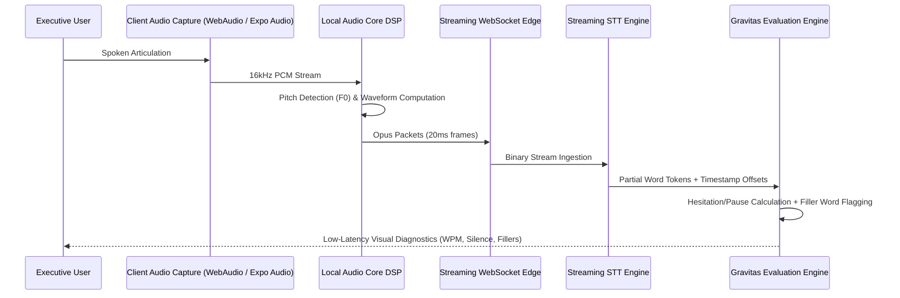

# ExecutiveVoice Audio & Signal Processing Pipeline

## 1. Real-Time Audio Capture Topology

---

## 2. DSP & Biometric Metric Extraction

### Fundamental Frequency ($F_0$) & Chest Resonance
- Chest resonance correlates with lower fundamental frequency and rich harmonic overtones in the 100Hz – 300Hz band.
- Laryngeal stress/uptalk produces sudden spikes in pitch trajectory ($dF_0/dt > \theta$) at the termination of declarative sentences.
- The pipeline flags uptalk as a question-inflection defect when the sentence is syntactically declarative.

### Words Per Minute (WPM)
Calculated continuously over a rolling 15-second sliding window:
$$\text{WPM}(t) = \frac{\sum_{i=1}^{N} \text{word}_i}{\Delta t_{\text{seconds}}} \times 60$$
- **120 – 150 WPM:** Optimal Executive Cadence (Commands gravitas and deliberate thought).
- **> 165 WPM:** Rushing / Anxious / Insecure delivery.
- **< 110 WPM:** Halting / Hesitant delivery.

### Strategic Pause Detection vs. Hesitation
- **Strategic Pause (Positive):** 2.0s – 3.5s duration following an interviewer question or between PREP steps, marked by zero vocal noise.
- **Anxious Hesitation (Negative):** Micro-pauses punctuated by vocal fillers (`um`, `uh`, `like`, `sort of`).
